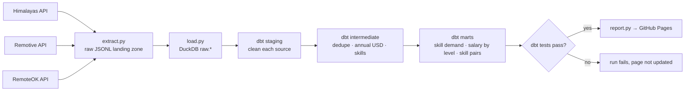

# Remote Jobs Pipeline

[](https://github.com/Jesus-Jazisenot/remote-jobs-pipeline/actions/workflows/ci.yml)
[](https://github.com/Jesus-Jazisenot/remote-jobs-pipeline/actions/workflows/pipeline.yml)

A daily **ELT pipeline** that answers one question: *which skills do remote tech jobs ask for, and what do they pay?*

It pulls ~870 postings a day from three public job APIs, loads them untouched into **DuckDB**, models them with **dbt** (29 models and data tests) and publishes a static report to **GitHub Pages**. Everything runs on a GitHub Actions schedule. No servers and no cost.

**Live report:** https://jesus-jazisenot.github.io/remote-jobs-pipeline/ · **Lineage graph:** [/dbt](https://jesus-jazisenot.github.io/remote-jobs-pipeline/dbt/)



## What it found (Sep 23, 2026)

| | |
|---|---|
| Tech postings analyzed | 551 (118 with a published salary) |
| Most requested | REST APIs 50% · Python 49% · LLMs/GenAI 39% · Automation 36% · JavaScript 34% |
| Best paid (median) | AI agents $184k · Machine Learning $175k · LLMs/GenAI $175k |
| Median by level | junior $86k (only 7 with salary) · mid $125k · senior $168k |
| Most common pair | Python + REST APIs (139 postings) |

## Design decisions

- **ELT, not ETL.** Extraction saves the API payloads *exactly as received* (`data/raw/<source>/<date>.jsonl`). If a transformation has a bug, dbt re-runs over the originals without calling the APIs again.
- **Idempotent loads.** `load.py` rebuilds each raw table from the whole landing zone with `union_by_name`, so API schema drift (new or removed fields) doesn't break it, and running twice gives the same result.
- **Tests gate the publish.** `dbt build` runs models and tests in dependency order. If a test fails (duplicate IDs, a source that returned nothing, min salary > max), the run stops and yesterday's page stays up instead of showing broken numbers.
- **Messy data is handled in SQL:** free-text salaries (`"$90k - $105k"`, `"50-70 USD/hour"`) are parsed with regex; hourly/monthly/EUR/GBP pay is normalized to annual USD; postings that appear on several boards are deduplicated, keeping the one with a salary.
- **Skills are data, not code.** Detection runs from a seed table (`seeds/skills.csv`: 51 regex patterns). The patterns are case-insensitive except where it matters: `Go` the language vs. "go" the verb. There is a test for exactly that.
- **DuckDB** because the whole warehouse is one file that runs anywhere, CI included. The same dbt models would run on Snowflake/BigQuery by changing the adapter.

## Project layout

```
pipeline/
  extract.py      3 APIs -> data/raw/*.jsonl (retries; one source failing doesn't stop the others)
  load.py         raw JSONL -> DuckDB raw schema
  report.py       marts -> docs/index.html
  run.py          orchestrates everything (--fixtures runs offline)
transform/        dbt project
  models/staging/       one view per source: rename, type, strip HTML, parse salary text
  models/intermediate/  int_jobs (union, dedupe, annual USD, level) · int_job_skills
  models/marts/         fct_tech_jobs · mart_skill_demand · mart_salary_by_level · mart_skill_pairs
  seeds/                skills.csv · currency_rates.csv
  tests/                singular data tests
tests/            end-to-end pytest over sample payloads (no network)
.github/workflows ci.yml (lint + tests on every push) · pipeline.yml (daily run + Pages deploy)
```

## Run it

```bash
python -m venv .venv && source .venv/bin/activate   # Windows: .venv\Scripts\activate
pip install -e ".[dev]"

python -m pipeline.run              # live: extract -> load -> dbt build -> report
python -m pipeline.run --fixtures   # offline, with the sample data in tests/fixtures
pytest -q                           # end-to-end tests
```

Open `docs/index.html`, or explore the warehouse with `duckdb data/warehouse.duckdb`.

## Limitations and next steps

- Only 20% of postings publish salary, and those that accept candidates from Mexico are fewer still: medians with small *n* are noisy (the report shows *n*).
- Each daily run is independent. The next step is to persist the landing zone (object storage) and make the marts **incremental**, to track how demand changes week over week.
- Skill detection is regex-based; an embedding classifier would catch paraphrases ("LLM" vs. "language models").

---

Built by [Jesús Rodríguez](https://github.com/Jesus-Jazisenot) · Data from the public APIs of Himalayas, Remotive and RemoteOK (used according to their terms; no scraping of HTML pages).
